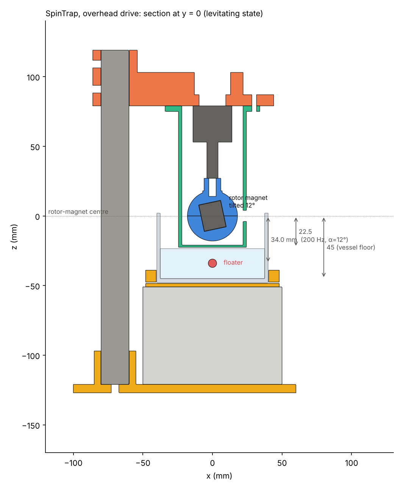

# SpinTrap prototype: build and test guide

Status: **designed and simulated, not built.** Every performance number below is a model
prediction (see `RESULTS.md` and `REVIEW.md` for how far to trust each one). Nothing here
has been measured.

## 1. Architecture (overhead drive, the recommended first build)

```
            2020 column ──┐
                          │  printed motor arm (motor_arm.stl)
   ┌──────────────────────┴──────┐
   │   A2212-class outrunner,    │   motor hangs UNDER the arm, shaft pointing down
   │   prop adapter              │   closed printed shroud (rotor_shroud.stl) surrounds motor + rotor
   │   ┌───────────┐             │
   │   │ rotor hub │ Ø36 sphere, 3/4"×5/8" N42 cylinder inside, tilted 12°
   │   └───────────┘   ── rotor-magnet centre (z = 0)
   └──── shroud floor (z = −22.5 mm) ──────
        ~~~~~~~~~~ water surface (≈ −23.5 mm) ~~~~~~~~~~
                 ●  6 mm NdFeB sphere floater (z ≈ −34 mm at 200 Hz, levitating)
        ───────── jar floor (z = −45 mm at end of approach) ─────────
                   80 mm wide-mouth glass jar on a lab jack
```



Design choices and the reason for each:

| Choice | Reason |
|---|---|
| Rotor magnet: axially magnetised **cylinder, L/D ≈ 0.83**, tilted α = 12° in a **spherical** hub | An L/D = √3/2 cylinder has isotropic inertia, so it can be tilted without dynamic imbalance, and its field has no octupole term. Sphere hub minus isotropic insert also has isotropic inertia. CAD check: 0.014 N m imbalance moment at 200 Hz, static imbalance ≈ 0 |
| α = 12° rather than 10° | The adversarial review found **no equilibrium at α = 8°, 200 Hz**. 12° keeps the design inside the existence region for ±2° holder or magnetisation error. Printed hubs for 10° and 14° are included for tuning |
| Overhead drive | A bare NdFeB sphere in water has a net body force pointing *away* from the rotor, which is the stable side of the window (Fig. 3). No shell needed |
| Floater 6 mm sphere | Spheres are exact dipoles, cheap and isotropic. 5 mm and 8 mm move the operating frequency (design chart) |
| Rotor brought up to speed **before** the vessel approaches | Spinning up with the floater nearby always fails in simulation (it gets yanked into the shroud) |
| Closed-loop speed control with a Hall-latch tachometer | Depth sensitivity is about −0.15 mm/Hz, and the trap has lightly damped modes at 8–13 Hz |
| Closed shroud, no windows | It contains a 34 g magnet moving at 23 m/s rim speed |

## 2. Bill of materials

Prices are rough 2026 hobby-market figures in USD. "Spec" is what matters. Any vendor's part
that meets it is fine (supplier part numbers are deliberately not given; check the magnet
dimensions and grade on the listing).

| # | Qty | Item | Spec | ≈ $ |
|---|---|---|---|---|
| M1 | 1 | Rotor magnet | NdFeB cylinder 19.05 Ø × 15.88 mm (3/4″ × 5/8″), **axially** magnetised, N42–N52, Ni-coated. Metric alternative: 20 × 17 mm | 10 |
| M2 | 10 | Floater magnets | NdFeB spheres 6 mm, N35–N42 (also buy 5 mm and 8 mm for the size test) | 8 |
| E1 | 1 | Motor | BLDC outrunner, 2212 class, **1400 KV** (≥ 15 000 rpm no-load at 12 V), with prop adapter (M5 thread) | 12 |
| E2 | 1 | ESC | 30 A, standard 50 Hz PWM input (BLHeli_S / SimonK / AM32) | 10 |
| E3 | 1 | Supply | 12 V ≥ 5 A bench supply or 3S LiPo + fuse | 15 |
| E4 | 1 | Controller | Arduino Nano (ATmega328P) | 5 |
| E5 | 1 | Hall latch | US1881, TLE4945L or SS460S (bipolar latch, open drain) + 10 kΩ pull-up | 2 |
| E6 | 1 | Push button, LED + 1 kΩ, optional 10 kΩ pot | | 2 |
| H1 | 1 | 2020 aluminium extrusion, 250–300 mm | | 6 |
| H2 | 4 | M5 T-nuts + M5×10 screws | | 3 |
| H3 | 3 | **Brass** M3×30 screws + brass hex nuts (rotor hub) | non-magnetic, close to the rotor field | 3 |
| H4 | 4 | M3×6–8 screws (motor to arm) | | 1 |
| H5 | 3 | M3×12 screws + nuts (shroud to arm) | | 1 |
| H6 | 1 | Scissor lab jack, 100 × 100 mm | ~1 mm resolution is enough; smooth motion matters | 20 |
| H7 | 1 | Wide-mouth glass jar, OD 75–85 mm | | 5 |
| H8 | 1 | Epoxy (24 h, high strength) | bonds M1 in the hub | 8 |
| C1 | — | Distilled water, glycerol (USP) | for the viscosity test | 10 |
| T1 | 1 | LED panel (backlight), phone camera ≥ 60 fps, printed mm scale | measurement | — |
| T2 | (opt) | Hall probe / gaussmeter (±50 mT) | field calibration test T2 | 30–150 |
| T3 | (opt) | Optical tachometer | cross-checks the Hall tach | 15 |
| P | ~150 g | PETG filament | printed parts | 4 |

**Total ≈ $125** without the optional instruments.

### Printed parts (`cad/out/*.stl`, STEP alongside; source `cad/spintrap_cad.py`)

| Part | Material, settings | Notes |
|---|---|---|
| `rotor_hub_upper_a12`, `rotor_hub_lower_a12` | PETG or PC, **100 % infill**, 0.12 mm layers, flat face down | Split plane horizontal. a10/a14 variants for tuning |
| `rotor_shroud` | PETG, 4 walls, 60 % infill, floor 100 % | Containment. Print floor down |
| `motor_arm` | PETG, 50 % gyroid | Ribs up |
| `column_foot`, `vessel_cradle`, `align_gauge` | PLA or PETG, 20 % | |
| `float_shell_upper/lower` | PETG, 0.08 mm layers | Bottom-drive variant only |

## 3. Assembly

1. **Bond the rotor magnet.** Dry-fit M1 into the lower hub pocket. Mark north with a
   compass; it doesn't matter which way it faces, but record it. Mix 24 h epoxy, coat the
   pocket, seat the magnet, and close with the upper hub using three **brass** M3 screws,
   tightened evenly. Cure 24 h. Keep it away from steel tools: it is a 34 g N42 magnet.
2. **Balance check.** Thread the hub onto the prop adapter, finger-tight against the adapter
   cone, then mount the motor in the arm. Run it alone (no shroud floor near anything
   magnetic) at 100 → 250 Hz in 25 Hz steps. Stop at any audible buzz. A buzz at a
   particular speed is a structural resonance of the arm or column. Stiffen it or skip that
   band. If vibration grows with speed, the hub isn't seated concentric: remount it.
3. **Shroud.** Push the Hall latch into the outside boss pocket, flat face toward the rotor,
   leads up. Bolt the shroud flange under the arm with three M3×12.
4. **Column and foot.** Insert the 2020 column into the foot (M5 into the profile core from
   below). Clamp the arm so the spin axis is centred over the lab jack. Use the
   `align_gauge` in the cradle: the 2 mm hole must sit under the motor's shaft centre within
   ±1 mm, checked with a plumb line or a long 2 mm rod.
5. **Electronics.** Connect ESC signal → D9 and common GND. Hall latch: VCC 5 V, GND,
   OUT → D2 with a 10 kΩ pull-up to 5 V. Button D4 → GND, LED D13. **Do not** power the
   Nano from the ESC BEC and USB at the same time unless your ESC documents it as safe.
6. **Firmware.** Flash `firmware/spintrap_controller/spintrap_controller.ino` (Arduino IDE,
   board "Arduino Nano"). Open a serial monitor at 115200 baud, send `ARM`, then `S 100`.
   Confirm that `?` reports f ≈ 100 Hz and that the LED lights (locked within ±0.5 Hz).

## 4. Operating procedure (from the simulations)

1. Vessel on the lab jack, **lowered** (jar floor ≥ 80 mm below the rotor centre). Water
   about 22 mm deep, floater resting on the jar floor.
2. `ARM`, then `S 200`, and wait for the lock LED.
3. Raise the jack smoothly, taking about 3 s for the last 35 mm. At about 50 mm below the
   rotor the floater lifts off the floor and settles near 34 mm (prediction). Stop with the
   jar floor at about 45 mm below the rotor centre, i.e. 22 mm below the shroud floor.
4. To change the levitation depth, use `S <hz>`, 170–240 Hz (Fig. 2, α = 12° curve).
5. **Shutdown:** `L` (ramps to 150 Hz; the floater detaches and lands), then lower the jack
   ≥ 30 mm, **then** `X!`. Never stop the motor with the floater within ~5 cm: at low
   speed the rotor is just a strong magnet.

## 5. Test plan and success criteria

Each test states its model prediction *before* the experiment. The α = 12° predictions use
the exact-cylinder field model.

| Test | Procedure | Prediction | Pass criterion |
|---|---|---|---|
| T0 Spin safety | §3.2 without floater, to 250 Hz | no resonance in 150–250 Hz | runs 10 min at 250 Hz, shroud temperature < 40 °C |
| T1 Speed control | `LOG 1`, hold 200 Hz for 60 s | | RMS speed error < 0.3 Hz; no ripple > 0.1 Hz at 5–15 Hz |
| T2 Field calibration (optional) | gaussmeter on axis 34 mm below the rotor: DC (static) and AC (rotating) readings | Bz,static 4.9 mT, B_rot 11.7 mT | within ±15 %. The ratio fixes the actual tilt α; use that α in the model before T4 |
| T3 Capture | §4 steps 1–3, 10 attempts | lift-off when the jar floor passes ≈ 50 mm, i.e. inside the 52.6 mm separatrix | ≥ 8/10 captures |
| T4 Depth vs frequency (**main quantitative test**) | after capture, step 240 → 170 Hz in 10 Hz steps, 20 s dwell, side video (`tools/track_floater.py`) | 220: 31.7, 200: 34.0, 180: 37.1 mm (water) | monotonic. Model within ±3 mm at every point after one-parameter refit of α from T2 or from the 200 Hz point |
| T5 Trap modes | tap the column at 200 Hz; track the floater at ≥ 60 fps | lowest mode 10.6 Hz, 1/e decay ≈ 2.5 s (water) | frequency within ±25 %, decay time within ×2 |
| T6 Fluid independence | repeat T4 in 50 % w/w glycerol–water | same depth (±0.5 mm); decay 1.8 s | depths agree within 1 mm |
| T7 Landing | `L` from levitation | detaches between 200 and 150 Hz and lands | 10/10 soft landings, no contact with the shroud |
| T8 Endurance | 60 min at 200 Hz | no drift | depth drift < 1 mm; no contact in video |
| T9 Mixing | drop of food dye 10 mm from the floater | slow swirl about the vertical (body ω_z ≈ 1250 rpm), mixing power ≈ 1.7 mW | qualitative; compare with an unstirred control |
| T10 Tilt (optional) | tilt the whole stand 10° | floater shifts ≈ 3 mm sideways, stays trapped | trapped |

### What counts as proof

* **That it is contactless:** backlit side video showing liquid all around the floater.
  Also: (i) a thin nylon loop passed fully around the floater, top to bottom and side to
  side, while it levitates; (ii) the floater re-centres after T10 tilts; (iii) a 24 h run
  with the floor and shroud showing no wear marks.
* **That it is the mechanism described, and not an artefact:**
  * the T4 curve has the predicted shape (depth falls with f, with a slope of
    −0.15 mm/Hz near 200 Hz);
  * the T5 mode frequency and decay match;
  * **depth is independent of viscosity while damping is not** (T6);
  * the floater ends up at the *repulsive* short-range side, a place a static magnet could
    never hold it. If any of these fail, the model is wrong in a way that matters, even if
    the floater levitates.

## 6. Variant B: bottom drive (classic stirrer layout)

The rotor goes under the vessel floor, and the floater is a 6 mm sphere inside the printed
16 mm buoyancy shell (`float_shell_*`; 1.26 g of PETG, net buoyancy ≈ −0.05 W₀). Simulation:
stable 40–100 Hz, 4.3–2.4 cm above the rotor. **Capture works only by lowering the vessel
onto the spinning rotor** (4/4 trials at 45 Hz, 0/4 at 60 Hz, where the trap touches the
floor). It is more convenient but more sensitive: about +0.2 g of extra shell mass (excess
epoxy, for example) pushes the floater out of the stable window. These variant-B numbers
come from the dipole model with α = 10° and have not been through the adversarial battery. Build it only after the overhead version works.
