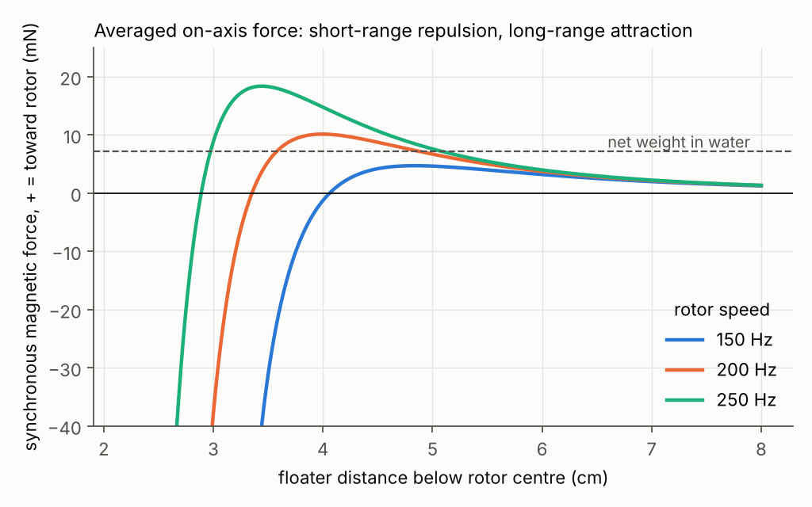
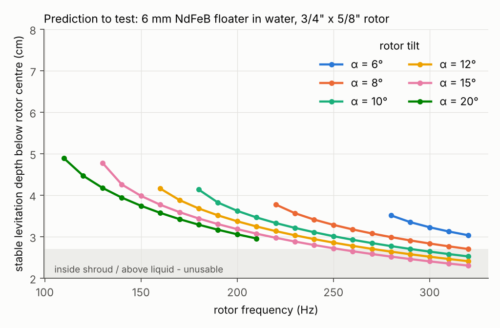
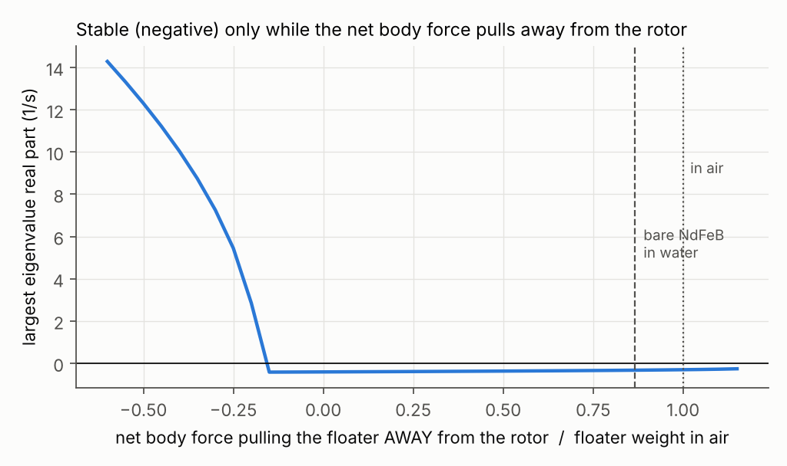
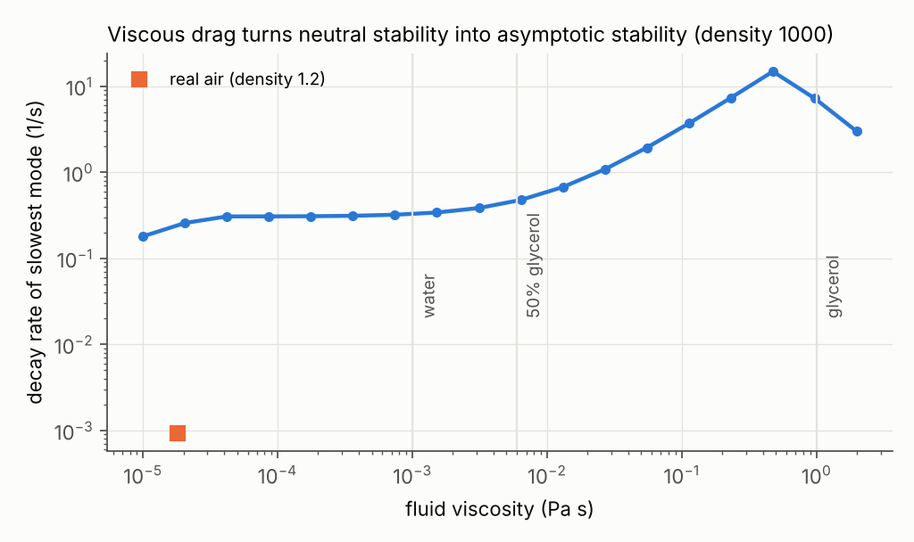
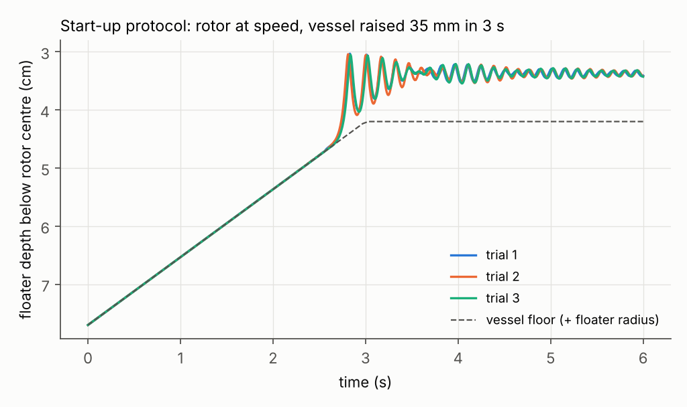
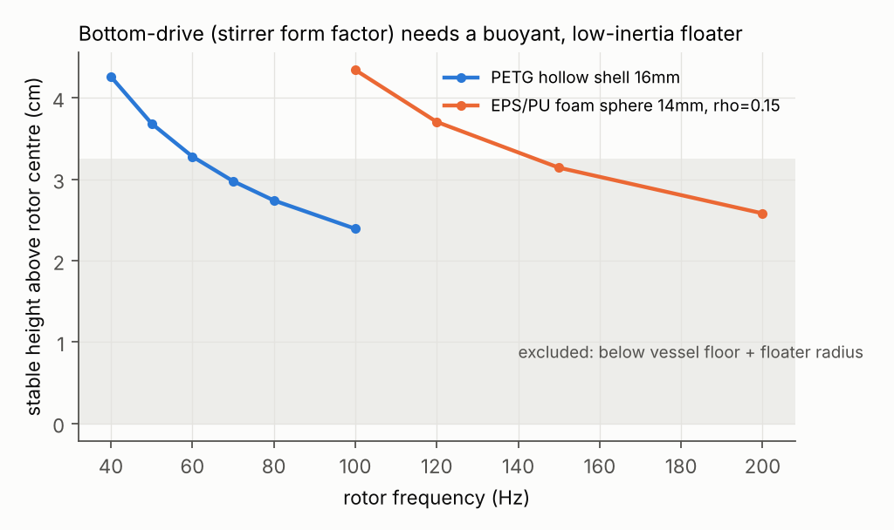

# Computational results

Everything here is **simulation**. No hardware has been built or measured. Where a number
comes from the first-pass α = 10° design point rather than the final α = 12°, it says so.

| Result | Value | Source |
|---|---|---|
| Model reproduces levitation in air (6 mm floater, 19 mm-class rotor, 200 Hz, α = 10°) | equilibrium 3.4–3.7 cm below the rotor; eigenvalues purely imaginary (neutral) without damping | `sim/check_eq.py`, `sim/test_rot.py` |
| Model reproduces the published floater orientation | moment near the spin axis, tilted 15–19° *parallel* to the rotor's in-plane moment (anti-aligned with the local field) | `sim/rotframe.py` |
| Liquid makes the state asymptotically stable | slowest decay 0.33 s⁻¹ (water), 0.48 s⁻¹ (50 % glycerol), up to 15 s⁻¹ at ~0.5 Pa s | Fig. 4, `sim/viscosity.json` |
| Depth almost independent of viscosity | 200 Hz, α = 12°: 34.0 mm in water, 34.0 mm in 50 % glycerol | `REVIEW.md` §2 |
| Body-force window | stable for net body force from −0.15 W₀ (toward the rotor) to ≈ +1.2 W₀ (away) | Fig. 3, `sim/map_weight.py` |
| Capture | 0/48 spin-ups with the floater nearby succeed; 5/5 overhead and 4/4 bottom-drive (45 Hz) succeed when the vessel approaches an already-spinning rotor | Fig. 5, `sim/capture*.py` |
| Landing | 200 → 150 Hz over 2 s lands the floater softly; going below ~100 Hz with the vessel close pulls it into the shroud | `sim/robust_rampdown.json` |
| Tilt tolerance (whole apparatus) | trapped up to 30°, offset 8.5 mm (α = 10°) | `sim/robust_tilt.json` |
| Impulse tolerance | recovers from 0.5 m/s lateral kicks, lost at 0.8 m/s (α = 10°) | `sim/robust_kick.json` |
| Final design point (α = 12°, 200 Hz, water, exact cylinder field) | depth 34.0 mm, separatrix 52.6 mm, lowest mode 10.6 Hz, τ = 2.5 s, mixing power 1.7 mW, mean body rotation 1250 rpm | `REVIEW.md`, `PROTOTYPE.md` |
| Depth vs frequency (α = 12°, water) | 220 Hz: 31.7, 200: 34.0, 180: 37.1 mm | Fig. 2, `sim/design_chart_6mm_water.json` |
| Bottom drive (16 mm PETG shell) | stable 40–100 Hz, 4.3–2.4 cm above the rotor (dipole, α = 10°) | Fig. 6, `sim/bottom_drive.json` |
| Rotor balance (CAD) | static imbalance ≈ 0; dynamic imbalance 0.014 N m at 200 Hz | `cad/check_massprops.py` |
| Adversarial battery | see `REVIEW.md` | `sim/adversarial*.py`, `sim/drag_ratio.py`, `sim/ripple.py` |








## Reproducing

```
pip install numpy scipy numba matplotlib cadquery
cd sim
python test_rot.py            # equilibria + eigenvalues, air/water/glycerol
python design_chart.py 0.006 water
python adversarial.py; python adversarial2.py; python drag_ratio.py; python ripple.py
python make_figures.py
cd ../cad && python spintrap_cad.py && python check_massprops.py && python assembly.py && python section_view.py
```
